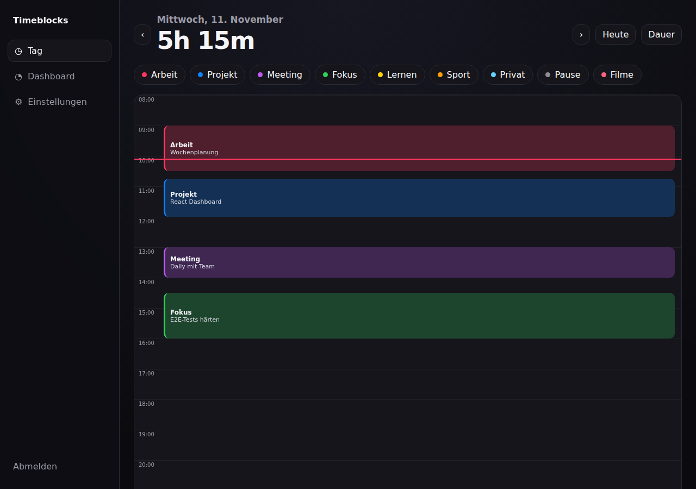

# Timeblocks

Lokale Zeiterfassung für dein Heimnetz – als Proxmox-LXC in wenigen Minuten installiert.
Timer-Chips, Tages-Timeline und Dashboard für den schnellen Alltag –
vollständig eigenständig entwickelt, ohne externe Dienste oder Fremd-Assets.



## Funktionen

- **Timer-Chips**: mehrere Kategorien, pro Kategorie ein Timer, ein Tap startet/stoppt.
- **Timeline**: Tag von oben nach unten, Blöcke ziehen und an den Rändern ziehen (5-Minuten-Raster),
  Lücken antippen für einen Nachtrag, Löschen mit Undo.
- **Detail pro Eintrag**: Freitextfeld mit kategorieabhängigem Platzhalter; erscheint in der
  Tagesliste und als Spalte `Detail` im CSV-Export.
- **Nachträge**: Start/Ende frei eintragen, auch über Mitternacht, mit Warnung bei Überschneidung.
- **Dashboard**: Woche, Monat, Jahr oder eigener Bereich mit KPIs (Heute/Woche/Monat/Gesamt),
  Kategorie-Donut, Top-Kategorien, Heatmap, Trend, Tages-Tabelle und CSV-Export.
- **Einstellungen**: Kategorien anlegen, umbenennen, Farbe ändern, archivieren, Detail-Label
  je Kategorie; Arbeitszeitbeginn pro Tag (z. B. 04:00), Woche-Start, Zeitzone, Theme,
  Export/Import.
- **PWA**: auf dem Homescreen installierbar, offlinefähige Hülle, keine externen Ressourcen.
- **Datenschutz**: SQLite-Datei auf deinem Server, kein Cloud-Konto, keine Telemetrie.
- **Erststart**: Seed-Kategorie `Filme` mit dem Detail-Platzhalter „Welcher Film?“.

## Schnellstart (Proxmox VE 8/9)

Auf dem **Proxmox-Host** als root:

```bash
bash -c "$(wget -qLO - https://raw.githubusercontent.com/HatchetMan111/ZeitTracking/main/install/timeblocks.sh)"
```

Das Skript legt einen unprivilegierten Debian-13-LXC an (Fallback 12), installiert
Python/Flask/gunicorn, richtet den systemd-Service ein und gibt am Ende URL und Zugangsdaten aus.
Standard: Hostname `zeiterfassung`, 2 vCPU, 1024 MB RAM, 8 GB Disk, DHCP, Port **8080**,
Start beim Booten.

### Optionen

```bash
bash timeblocks.sh --help
```

| Option | Bedeutung |
| --- | --- |
| `--ctid ID` | Container-ID (Default: nächste freie) |
| `--hostname NAME` | Hostname (Default `zeiterfassung`) |
| `--cores N` / `--memory MB` / `--disk GB` | Ressourcen (2 / 1024 / 8) |
| `--storage NAME` | RootFS-Storage (Auto-Erkennung, bevorzugt `local-lvm`) |
| `--template-store N` | Storage für das LXC-Template (Default `local`) |
| `--bridge NAME` | Netzwerk-Bridge (Default `vmbr0`) |
| `--ip CIDR` / `--gw IP` | Statische IP statt DHCP |
| `--port PORT` | Port der Web-UI (Default `8080`) |
| `--password PW` | Login für die Web-UI aktivieren (Default: kein Login, nur LAN) |
| `--ssh-key PATH` | SSH-Public-Key in den Container übernehmen |
| `--reboot-test` | Nach der Installation neu starten und Health-Check wiederholen |
| `--uninstall` | Container stoppen und löschen (braucht `--ctid`) |
| `--yes` | Rückfragen automatisch bestätigen |
| `--debug` | `bash -x` und vollständige Fehlerkette im Log |

Bestehende Installationen mit Hostname `timeblocks` werden beim erneuten Lauf mit derselben
CT-ID auf `zeiterfassung` umbenannt, z. B. `bash timeblocks.sh --ctid 109`. Ein eigenes
`--hostname` wird nicht überschrieben: Ohne explizites `--hostname` bricht das Skript bei
einem abweichenden Custom-Namen mit Hinweis ab.

Beispiel mit fester IP und Login (Skript herunterladen, dann mit Optionen starten):

```bash
wget -qO /tmp/timeblocks.sh https://raw.githubusercontent.com/HatchetMan111/ZeitTracking/main/install/timeblocks.sh
bash /tmp/timeblocks.sh --ip 192.168.1.50/24 --gw 192.168.1.1 --password 'mein-passwort'
```

Alternativ per Umgebungsvariable mit dem Einzeiler, z. B. anderer Port:

```bash
APP_PORT=8090 bash -c "$(wget -qLO - https://raw.githubusercontent.com/HatchetMan111/ZeitTracking/main/install/timeblocks.sh)"
```

## Nach der Installation

```bash
pct exec <CTID> -- systemctl status timeblocks
pct exec <CTID> -- journalctl -u timeblocks -f
```

- Web-UI: `http://<container-ip>:8080`
- Dienst: `timeblocks.service`, läuft als Systembenutzer `timeblocks`
- Code: `/opt/timeblocks` (Git-Checkout)
- Daten: `/var/lib/timeblocks/timeblocks.db` (SQLite, WAL)
- Konfiguration: `/etc/timeblocks.env` (z. B. `TIMEBLOCKS_PASSWORD`)
- Update im Container: `timeblocks-update`

## Update

```bash
pct exec <CTID> -- timeblocks-update
```

Das Skript holt den aktuellen Stand (`git fetch` + Reset), aktualisiert bei venv-Installationen die Python-Pakete und startet den Dienst neu inklusive Health-Check.

## Backup

Die Datenbank im WAL-Modus sicher kopieren:

```bash
pct exec <CTID> -- sh -c 'sqlite3 /var/lib/timeblocks/timeblocks.db ".backup /tmp/tb-backup.db"'
pct pull <CTID> /tmp/tb-backup.db ./timeblocks-$(date +%F).db
```

Wiederherstellen: Dienst stoppen, `timeblocks.db` ersetzen (WAL/SHM-Dateien löschen), Dienst starten.

## Deinstallation

```bash
wget -qO /tmp/timeblocks.sh https://raw.githubusercontent.com/HatchetMan111/ZeitTracking/main/install/timeblocks.sh
bash /tmp/timeblocks.sh --uninstall --ctid <CTID>
```

Der Container wird gestoppt und zerstört; die Datenbank liegt ausschließlich darin.

## Lokale Entwicklung

Backend (Flask auf Port 8100):

```bash
python3 -m venv .venv && . .venv/bin/activate
pip install -r requirements-dev.txt
TIMEBLOCKS_DATA_DIR=/tmp/timeblocks-dev PORT=8100 python3 -m app.app
python3 -m pytest -q
```

Frontend (Vite, proxyt `/api` nach `127.0.0.1:8100`):

```bash
cd web
npm ci
npm run dev        # http://127.0.0.1:5173
npm run test
npm run typecheck
npm run build      # schreibt den Produktions-Build nach app/static
```

Vor einem Commit mit Frontend-Änderungen immer `npm run build` ausführen, damit
`app/static` mit dem Quellstand übereinstimmt. Im LXC läuft kein Node/npm; der
committete Build wird per `timeblocks-update` mit ausgeliefert.

Für einen produktionsnahen Backend-Lauf:

```bash
TIMEBLOCKS_DATA_DIR=/tmp/timeblocks-dev gunicorn --chdir app --bind 127.0.0.1:8100 app:app
```

## Sicherheit

- Ohne `--password` gibt es **keinen Login**. Nur in einem vertrauenswürdigen LAN betreiben
  oder `--password` setzen bzw. einen Reverse-Proxy mit TLS davorstellen.
- Der Container ist unprivilegiert; der Dienst läuft ohne Root-Rechte mit
  `ProtectSystem=strict`, `ProtectHome=true`, `NoNewPrivileges=true`.
- Setzt sichere HTTP-Header (CSP ohne Inline-Skripte, `X-Frame-Options: DENY`, `nosniff`).

## API (Auszug)

`GET /api/health`, `GET /api/state`, `GET /api/day?date=YYYY-MM-DD`,
`POST /api/timers/<category>/start`, `POST /api/timers/stop`,
`POST /api/entries`, `PATCH /api/entries/<id>`, `DELETE /api/entries/<id>`,
`GET /api/summary`, `GET /api/stats?from=…&to=…`,
`GET /api/export.csv?from=…&to=…`.

## Lizenz

MIT – siehe [LICENSE](LICENSE).
